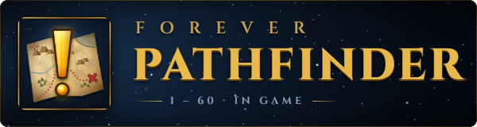
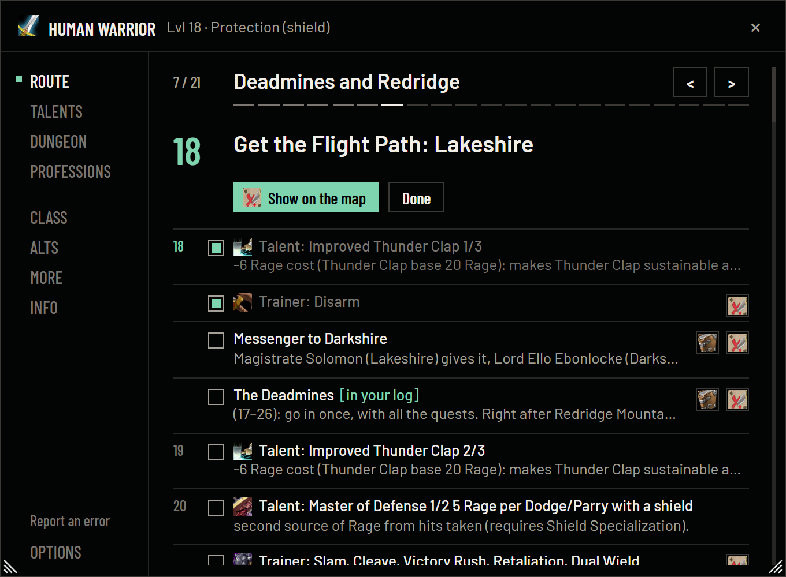
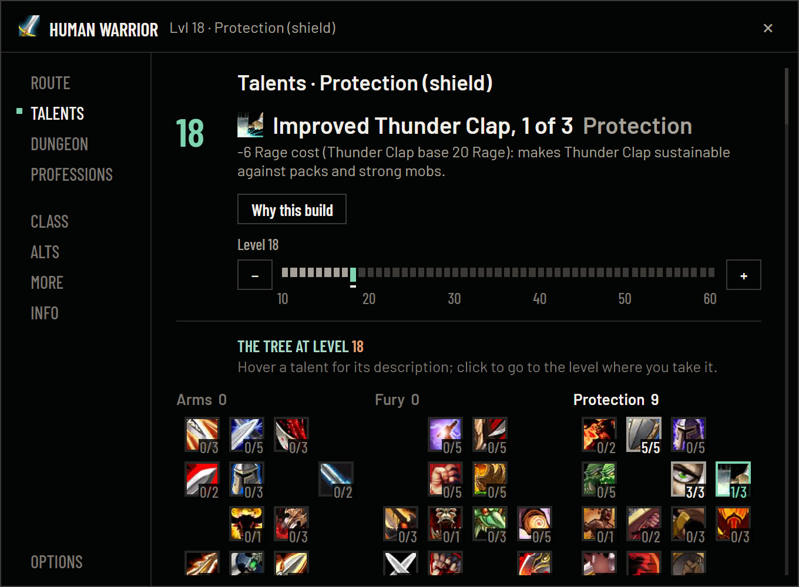
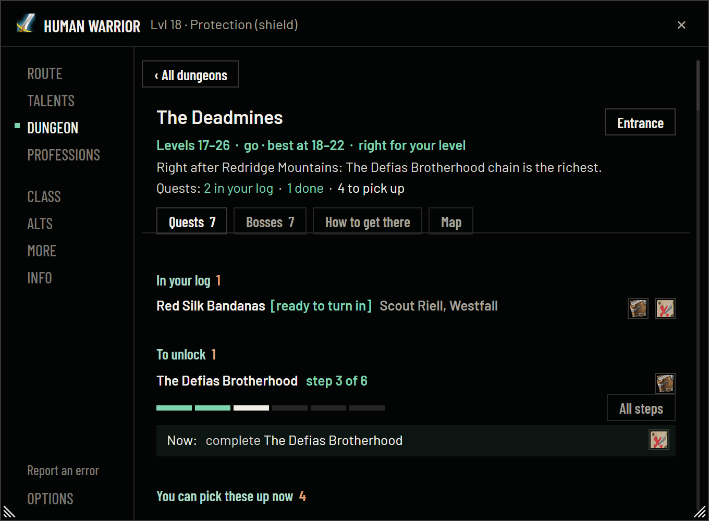
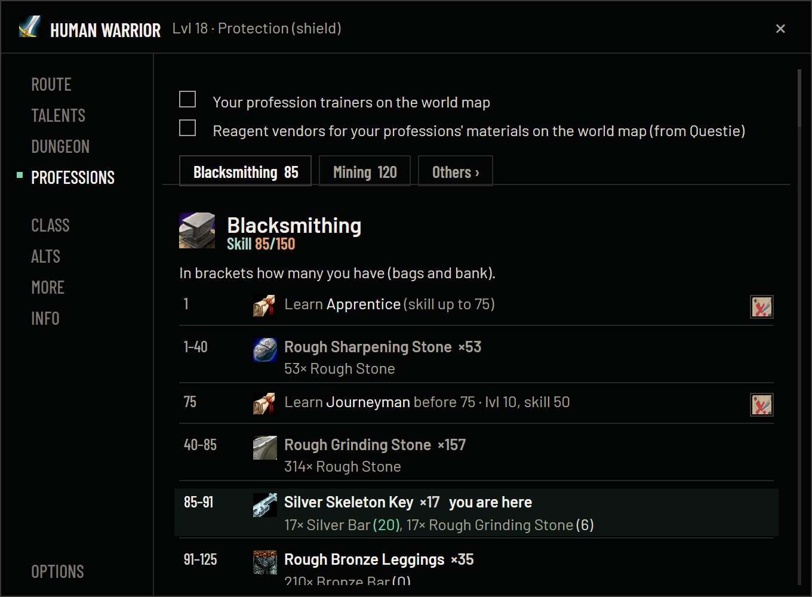

  
  
  
  

A free leveling guide for **WoW: Forever**, from 1 to 60, for every race (Skyborne included) and every class. Two ways to use it, same data:

- **The website**: [foreverpathfinder.github.io](https://foreverpathfinder.github.io/). Made to sit on your phone next to the PC, with the interactive game map.
- **The addon**: the whole guide in a window inside the game. [CurseForge](https://www.curseforge.com/wow/addons/forever-pathfinder) · [how to install](https://foreverpathfinder.github.io/addon.html).

## What you get

- **Route**: the next thing to do, step by step, for your starting zone. With the addon, items tick themselves when you turn in the quest, and the map button drops a waypoint where Questie says.
- **Talents**: the build at any level, with up to three builds per class to pick from, rotation, spells and racials.
- **Dungeons**: a verdict per faction, the quests to pick up first, bosses in order with tips, a map of the inside and the entrance, checked against the game.
- **Professions**: the 1–300 route, materials, and the trainer to visit at each cap.
- **Alts**: which alt to make next and how the Legacy points work.
- **Several characters** saved on the website, a save file, moving to another device, an app on the Home screen.
- **English or Italian**, on the website and in the addon. Game names stay in English.

## How the guide is made

Builds follow the most voted leveling guides on Mobalytics, with Icy Veins and the game data for the others. Routes, quests, zones, dungeon quests and entrances are checked against live game data (Wowhead, Questie's database, the game files). Every tip says whether it is confirmed by several sources, comes from a single one, or is new in Forever, and the website lists every source with its date.

Found a mistake? [Report it](https://foreverpathfinder.github.io/report.html) (no account needed) or [open an issue](https://github.com/foreverpathfinder/foreverpathfinder.github.io/issues).

## Support

If the guide saves you some time, you can buy me a coffee:

## Italiano

Guida di leveling gratuita per **WoW: Forever**, dall'1 al 60, per tutte le razze (Skyborne inclusi) e tutte le classi. Il [sito](https://foreverpathfinder.github.io/) è fatto per stare sul telefono accanto al PC, con la mappa del gioco; l'[addon](https://foreverpathfinder.github.io/addon.html) porta la stessa guida dentro il gioco, con le voci che si spuntano da sole e i segnaposti di Questie. Percorso, talenti a ogni livello, dungeon con quest, boss, mappa e ingresso, profession e alt. Testi in italiano e inglese. Errori? [Segnalali qui](https://foreverpathfinder.github.io/report.html), senza account.

## Development

- Data in `src/data/`, texts in `src/i18n/` (Italian is the source, `en.json` the English).
- `node src/tools/build.js` builds the website pages; `node src/tools/addon.js` builds the addon data and the zip; `node src/tools/test.js` and `node src/tools/addon-test.js` run the checks.
- The full working guide (in Italian) is `src/AGGIORNARE.md`.
- When the version in `addon/ForeverPathfinder/ForeverPathfinder.toc` changes, a GitHub workflow uploads the zip to CurseForge as a beta.

Fonts: Barlow by Jeremy Tribby, SIL Open Font License. No Blizzard files are included in the addon: game icons are used by name. Addon license: MIT (`addon/LICENSE`).

*Free personal project, not affiliated with Blizzard Entertainment. World of Warcraft, icons and maps © Blizzard Entertainment; map tiles and data via Wowhead.*
